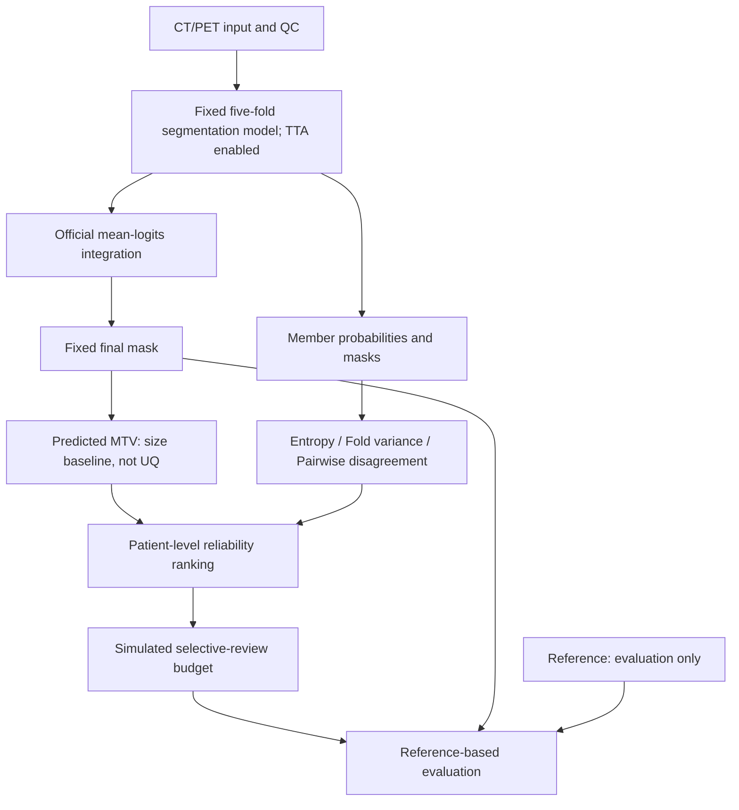

# Patient-Level Reliability Assessment for Quantitative Whole-Body PET/CT Segmentation

[Synthetic fixed-mask selective review](docs/SYNTHETIC_SELECTIVE_REVIEW_DEMO.md): `python scripts/demo_fixed_mask_selective_review.py` (synthetic only; no clinical claim).

## Clinical Problem

After PET/CT segmentation is fixed, which examinations may contain substantial spatial error and should receive priority under a limited human review budget? This repository presents inspectable engineering, a separate five-case training record, and a 20-case FDG development pilot. Independent reliability and clinical benefit remain untested.

Start with the [one-page research overview](docs/PI_RESEARCH_OVERVIEW.md), inspect the [claim-to-evidence matrix](docs/PI_EVIDENCE_MATRIX.md), then review the [proposed research gates](docs/RESEARCH_GATES.md).

## Technical Workflow

The diagram describes the protected FDG20 workflow, not a public end-to-end runner or the separate 40-epoch training experiment.



Five folds have overlapping training sets; they are **not five independent seeds**. Reference masks enter evaluation and post-hoc error analysis only, never prediction or reference-free scoring. The official final mask is distinct from mean member probability used for scoring.

## Verified Engineering and Development Evidence

| Evidence track | Inspectable evidence | Status and boundary |
|---|---|---|
| QC, quantification, evaluation, reliability, provenance and synthetic PyTorch | [Implementation–test pairs](docs/PROGRAMMING_EVIDENCE.md) | `ENGINEERING_SMOKE`: synthetic/analytic behavior, not clinical validity |
| Real 40-epoch training and checkpoint evaluation | [Five-case record](docs/DEVELOPMENT_BASELINE_40E_CASE.md), [aggregate JSON](docs/development_baseline_40e_summary.json) | `DEVELOPMENT_EXPOSED`: one seed, fold 0; final versus EMA-selected checkpoint; insufficient clinical performance |
| FDG20 fixed-prediction reliability analysis | [Methods](docs/FDG20_PILOT_METHODS.md), [aggregate JSON](docs/fdg20_pilot_aggregate_summary.json), [released figure](docs/figures/fdg20_pilot_aggregate.png) | Completed development analysis; training exposure not excluded; aggregate-only public evidence |
| Independent FDG, clinically adjudicated lesion errors, reader study, PSMA/cross-centre validation | [Research gates](docs/RESEARCH_GATES.md) | `PROPOSED / NOT RUN`; SAP and clinical-reference SOP `PENDING` |

The five-case experiment is not pooled with FDG20. Its checkpoint rankings differ across Dice and net-volume error, and an analytic empty-mask control has lower volume MAE while missing all foreground. These are engineering failure-analysis observations, not high-accuracy segmentation or clinical-effectiveness evidence.

## FDG20 Development Pilot

**DEVELOPMENT / TRAINING_EXPOSURE_NOT_EXCLUDED; not independent validation.** The 20 availability-sampled cases contain 10 reference-foreground and 10 empty-reference annotations; empty reference does not establish clinical negativity. Spatial risk is `R_spatial = FPV + FNV` (mL), distinct from absolute net MTV error `E_MTV = |FPV − FNV|` and FNV alone.

| Score | Analysis status | Discrete AURC (mL) | Mean retained risk at 80% coverage (mL) |
|---|---|---:|---:|
| Entropy | Frozen primary analysis | 9.02 | 15.25 |
| Fold probability variance | Frozen primary analysis | 9.63 | 21.51 |
| Predicted MTV | Post-hoc size baseline; not UQ | 5.97 | 10.10 |
| Pairwise disagreement | Post-hoc | 58.64 | 35.70 |

Values are decimal round-half-up from the linked JSON, to two decimals. Frozen labels apply only to AURC and retained risk. Lower AURC is better: analytic random-order expectation is 28.63 mL; reference-informed oracle is 5.80 mL and is not deployable. **Pairwise disagreement performed worse than the random-order expectation.** Predicted MTV's proximity to the oracle is descriptive for this cohort, not a general advantage or a UQ result.

At a simulated 20% review budget (4 referred, 16 retained), the share of cohort FNV assigned to referrals was:

| Score | Referral-FNV share | Analysis status |
|---|---:|---|
| Entropy | 49.2% | Post-hoc |
| Fold probability variance | 23.7% | Post-hoc |
| Predicted MTV | 65.5% | Post-hoc |
| Pairwise disagreement | 0.0% | Post-hoc |

**All four shares are post-hoc.** They measure error allocation, not corrected errors, lesion sensitivity, reduced missed disease, saved reader time, or improved clinical safety. Computational common-uncovered regions are candidates, not clinically confirmed complete lesion misses. No clinically major false-negative endpoint was assessed. Exact values and metric-level labels remain in the [unchanged source JSON](docs/fdg20_pilot_aggregate_summary.json).

## Programming Contributions and Upstream Attribution

Repository implementations include [geometry QC](src/pet_ai/qc/geometry.py), [physical volume](src/pet_ai/quantification/volume.py), [segmentation evaluation](src/pet_ai/evaluation/segmentation.py), [risk–coverage and tie handling](src/pet_ai/reliability/risk_coverage.py), and [run provenance](src/pet_ai/reproducibility/run_manifest.py). [Programming evidence](docs/PROGRAMMING_EVIDENCE.md) links each behavior to tests, including the compact synthetic PyTorch path and public sampler/trainer adaptation.

These artifacts demonstrate inspectable implementation work, not sole authorship of all code. nnU-Net supplies its framework, architecture, training machinery and checkpoint selection; AutoPET supplies the dataset ecosystem; LesionTracer supplies the upstream FDG20 model family. See [third-party attribution](THIRD_PARTY.md) and [architecture](docs/ARCHITECTURE.md). The public adaptation is a `PARTIAL_RECIPE`, not byte-identical historical orchestration.

## PhD Research Roadmap

All three studies are **PROPOSED / NOT RUN**:

1. **Independent FDG fixed-score reliability validation:** audit exposure and data permissions, approve a SAP, then compare UQ against Predicted MTV with paired ΔAURC and patient-level confidence intervals.
2. **Conditional clinical missed-lesion and failure analysis:** approve reference completeness and lesion matching; distinguish voxel FNV, complete lesion misses and clinically major misses. Consider complementary cues or an auxiliary model only after a blind spot is clinically confirmed.
3. **Later reader study and PSMA/cross-centre validation:** measure actual reader cost and incremental benefit; evaluate tracer, centre, scanner and patient-spectrum shifts under separate protocols.

Current blockers are unavailable independent FDG data (search paused), unresolved exposure, pending SAP/reference SOP, historical execution-byte identity and checkpoint redistribution rights. Sample sizes, centres, expected effects, thresholds and approval decisions remain `TBD / PENDING`. The [auditable gates](docs/RESEARCH_GATES.md) elaborate the retained [research design candidate](docs/RESEARCH_DESIGN_CANDIDATE.md).

## Reproducibility and Evidence Limitations

With Python 3.10 or newer:

```powershell
python -m pip install -e ".[test]"
python -m ruff check .
python -m pytest -q -m "not pytorch"
python scripts/verify_public_repo.py
python scripts/demo_pipeline.py
python scripts/render_fdg20_public_figure.py --input docs/fdg20_pilot_aggregate_summary.json --output ./fdg20_summary.svg
```

With an existing compatible CPU PyTorch environment, also run `python -m pytest -q -m pytorch`. The SVG command displays public aggregates; it does not byte-reproduce the historical PNG. Synthetic tests and display checks cannot recompute protected patient-level FDG20 or five-case results, validate clinical references, or establish clinical benefit. Rendered visual QA is separate from structural checks.

Patient images, masks, member probabilities, case mappings, private orchestration and weights are excluded. Full reproduction needs separately governed data, historical execution code and permitted model artifacts. Hashes establish traceability, not clinical validity. See [data provenance](docs/DATA_PROVENANCE.md), [metric definitions](docs/METRICS.md), and the [evidence matrix](docs/PI_EVIDENCE_MATRIX.md) for exact sources and public reproducibility boundaries.
