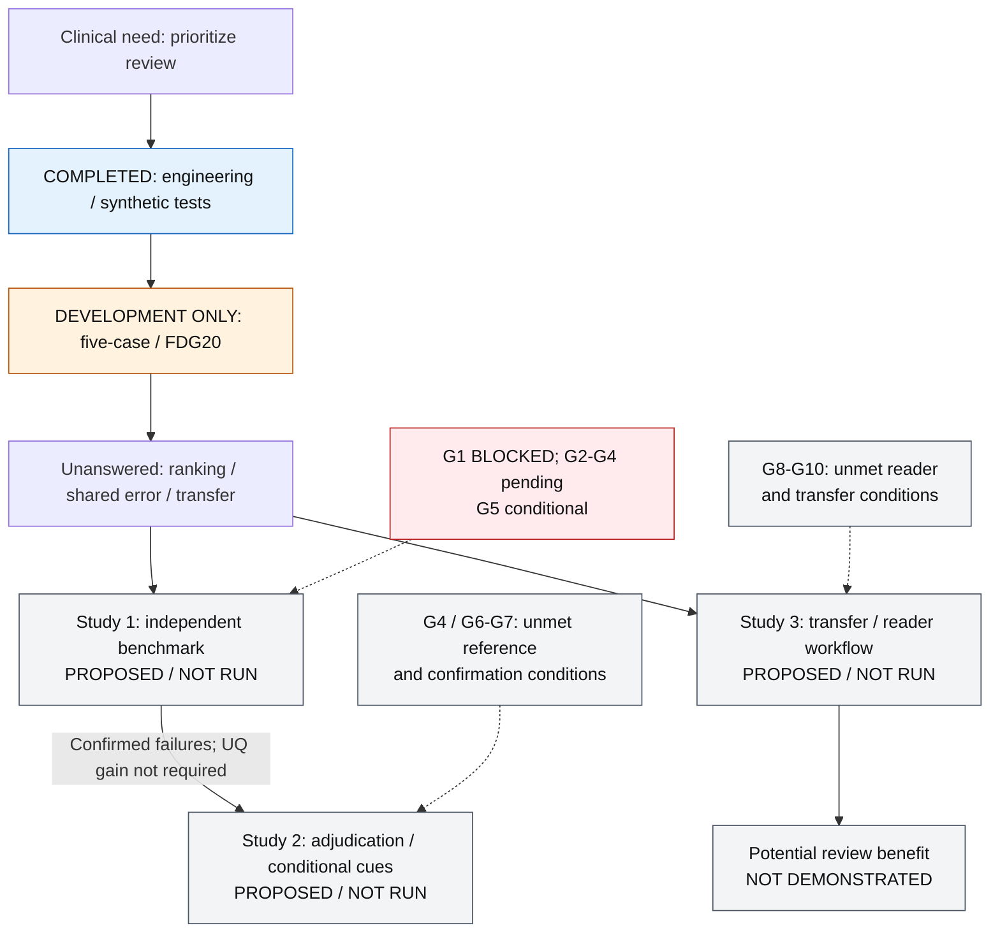

# From Quantitative Segmentation to Trustworthy PET/CT: Patient-Level Reliability, Silent Failure and Selective Review

**Candidate PhD framework, not a claim of demonstrated trustworthiness or safety.**
The new studies below are **PROPOSED / NOT RUN**. Existing engineering and
development results motivate questions; they do not answer them on independent
patients. This framework interprets the existing [design candidate](RESEARCH_DESIGN_CANDIDATE.md)
and [G1–G10](RESEARCH_GATES.md), without replacing either or changing their gates.

## Evidence legend

| Level | Meaning here | Permitted interpretation |
|---|---|---|
| A — VERIFIED ENGINEERING | Inspectable public implementation, tests and mathematical fixtures | Engineering behavior; no patient or clinical efficacy claim |
| B — COMPLETED DEVELOPMENT EXPERIMENT | Recorded real development runs and source-linked public aggregates | Descriptive observations within the recorded scope; not independent validation |
| C — VERIFIED PRIOR LITERATURE | Identified papers with bounded, location-specific support in the [literature register](RESEARCH_LITERATURE_EVIDENCE.md) | Findings for their original tasks; PET transfer remains conditional |
| D — PROPOSED / NOT RUN | This project's falsifiable research candidates | No new experiment, performance estimate or approval |
| E — UNKNOWN / BLOCKED | Missing provenance, access, independent cohort or approvals | No substitution of UNKNOWN with unexposed/eligible |

These labels organize claims, not scores of paper quality. Levels D/E do not
become A/B/C because a document or diagram is complete.

## Layer 1 — Clinical problem and unit of decision

**When automated PET/CT segmentation is used to quantify tumor burden, can
examinations at greater risk of spatial segmentation error be identified and
prioritized for expert review under a limited review budget?**

The proposed action is referral of an examination for review; it is not a
prognosis prediction or an automatic correction. Sampling and independence
are assessed at patient level. Multiple examinations of one patient require
grouped splits and clustered analysis. Voxels define physical error volume;
lesions require a separate matching/reference protocol. These units are not
interchangeable.

PET quantification depends on acquisition and delineation conventions
([L07](RESEARCH_LITERATURE_EVIDENCE.md#l07)); an annotated whole-body FDG
resource supplies relevant task context, not permission or independence for
our local records ([L08](RESEARCH_LITERATURE_EVIDENCE.md#l08)). For fixed binary
prediction P and reference G on a common validated physical grid:

- `FPV = volume(P outside G)` and `FNV = volume(G outside P)`, in mL;
- `R_spatial = FPV + FNV` measures symmetric-difference volume;
- `E_MTV = |FPV - FNV|` measures absolute net-volume error;
- Predicted MTV is `volume(P)`: a size baseline, **not UQ**.

Equal FPV/FNV can cancel in E_MTV while spatial error remains positive. Identical
members can also share an error. These are mathematical possibilities verified
by the [synthetic demo](SYNTHETIC_SELECTIVE_REVIEW_DEMO.md), **not confirmed
clinical missed lesions**. Dice is a reference-based overlap endpoint and is
unavailable as a reference-free deployment score. Neither agreement nor net
volume alone establishes which examination deserves review. Selection must
therefore be tested against an explicitly chosen error and action, consistent
with problem-aware metric selection ([L02](RESEARCH_LITERATURE_EVIDENCE.md#l02)).

## Layer 2 — What has actually been completed

| Separate track | Source and completed evidence | Boundary |
|---|---|---|
| 1. Public engineering — A | [Implementation–test pairs](PROGRAMMING_EVIDENCE.md): geometry/units QC, affine-aware volume, binary error and lesion utilities, expected-tie Risk–Coverage, manifests, synthetic PyTorch; [fixed-mask review](SYNTHETIC_SELECTIVE_REVIEW_DEMO.md) | Mathematical/engineering validation; artificial members are not trained folds or seeds; no clinical inference |
| 2. Five-case 40-epoch development — B | [Case record](DEVELOPMENT_BASELINE_40E_CASE.md), [numeric source](development_baseline_40e_summary.json): one seed, fold 0, final versus online-EMA-selected checkpoint | Development validation inspected during engineering; final/EMA from one run, not independent models; strict Dice uses three non-empty references, volume errors all five; not a reliability study |
| 3. FDG20 development pilot — B | [Methods](FDG20_PILOT_METHODS.md), [numeric source](fdg20_pilot_aggregate_summary.json): fixed official five-fold/TTA prediction path and mean-logits final mask | 20 availability-sampled examinations: 10 reference-foreground and 10 empty-reference annotations; not a prevalence cohort; empty annotation is not clinical negativity; TRAINING_EXPOSURE_NOT_EXCLUDED |

These tracks do not pool cases, models, statistical evidence or provenance.
Five contributing folds have overlapping training sets; they are not five
independent seeds. Historical checkpoint identity statements are not fresh
weight verification. [Data provenance](DATA_PROVENANCE.md) also contains an
older OOF technical track; it is not substituted for these experiments.

### Observation → interpretation → next question

Real numeric statements below come only from the linked JSON keys; rounded
display values use the repository's existing convention. They are not new
analyses or effect estimates.

| Recorded observation | Supported interpretation | Competing explanation / limitation | Unanswered question → next action |
|---|---|---|---|
| EMA-selected strict Dice 0.2187 versus final 0.09907, but volume MAE 63.21 versus 59.43 mL ([40-epoch JSON](development_baseline_40e_summary.json), `aggregates.ema_selected/final.strict_dice` and `absolute_volume_error_mL`) | Different objectives give different checkpoint rankings on this development set | Selection exposure, small denominators and FP/FN trade-off; not a training-duration effect | Which error matters for referral? → approve task-specific risks and an adequate fixed segmentation baseline before independent comparison |
| Analytic empty control MAE 33.30 mL is lower while missing all reference foreground (`aggregates.ANALYTIC_EMPTY_PREDICTION_CONTROL`) | Low net-volume error alone does not establish segmentation value | Annotation composition and burden affect this aggregate; the control is not trained inference | Can spatial risk reveal failures hidden by volume agreement? → evaluate R_spatial separately from E_MTV and FNV |
| FDG20 Entropy AURC 9.02 mL; post-hoc Predicted MTV 5.97 mL ([FDG20 JSON](fdg20_pilot_aggregate_summary.json), `methods[0/2].discrete_AURC_mL`) | No demonstrated incremental UQ advantage over the size baseline in this pilot | Development exposure, burden distribution, whole-grid background/FOV and post-hoc comparison; no causal explanation | Does Entropy add ordering value independently? → Study 1, with negative outcomes allowed |
| Post-hoc Pairwise disagreement AURC 58.64 mL versus analytic random expectation 28.63 mL (`methods[3]`, `references`) | The adverse ordering observation must be retained | Shared errors are possible, but not established as its cause; score aggregation, task and reference differences are alternatives | Why might agreement fail? → independent benchmark and, conditionally, clinically adjudicated Study 2; do not dismiss contrary prior art |
| Referral-FNV shares use `methods[*].metric_analysis_status.cohort_FNV_share_in_4_referrals = POST_HOC` for all four scores | Descriptive allocation under a simulated case budget | No observed reader correction, workload, lesion sensitivity or clinical benefit | Does referral improve actual decisions? → later approved reader evaluation under G8/G10 |

Frozen analysis applies to Entropy/variance AURC and retained-risk metrics only;
Predicted MTV/Pairwise comparisons are post-hoc. **All referral-FNV shares are
post-hoc.** No historical outcome is retrospectively preregistered here.

## Layer 3 — Theory-to-design bridge

The [register](RESEARCH_LITERATURE_EVIDENCE.md#theory-to-design-transfer-map)
gives original tasks, locations, assumptions and failure tests for T1–T6.
Its papers are prior art, not evidence that our PET proposal works.

| Topic | Literature-supported starting point — C | This project's transfer and missing test — D/E |
|---|---|---|
| T1 Selective prediction | Coverage and conditional retained risk are defined for classification in [L01](RESEARCH_LITERATURE_EVIDENCE.md#l01); segmentation failure evaluation is studied in [L06](RESEARCH_LITERATURE_EVIDENCE.md#l06) | Replace classification error by patient/examination spatial error; test ranking, not imported clinical risk guarantees |
| T2 Problem-aware metrics | [L02](RESEARCH_LITERATURE_EVIDENCE.md#l02) organizes metric selection by task properties | Pair spatial and volume errors with lesion outcomes only when references permit; no universal surrogate for severity |
| T3 Ensemble uncertainty | Deep ensembles [L04](RESEARCH_LITERATURE_EVIDENCE.md#l04), MRI structure QC [L05](RESEARCH_LITERATURE_EVIDENCE.md#l05) and CT/MRI failure benchmarking [L06](RESEARCH_LITERATURE_EVIDENCE.md#l06) motivate candidates | Mean-probability entropy is predictive uncertainty, not a pure epistemic decomposition; overlapping fold variance is not independent-seed evidence; shared-error sensitivity needs testing |
| T4 Quantitative PET | [L07](RESEARCH_LITERATURE_EVIDENCE.md#l07) describes quantitative/delineation conventions; [L08](RESEARCH_LITERATURE_EVIDENCE.md#l08) supplies annotated FDG context | Verify SUV, physical units, geometry and reference scope; derived error identities do not establish a clinical threshold |
| T5 Independence and shift | [L03](RESEARCH_LITERATURE_EVIDENCE.md#l03) requests patient-disjoint partitions; [L09](RESEARCH_LITERATURE_EVIDENCE.md#l09) demonstrates variable cross-hospital classification generalization | Audit every contributing member's exposures and assess tracer/site/spectrum separately; no existing independent PET result |
| T6 Clinical translation | [L10](RESEARCH_LITERATURE_EVIDENCE.md#l10) concerns live clinical evaluation; PET/CT uncertainty/referral already has task-specific prior art [L11](RESEARCH_LITERATURE_EVIDENCE.md#l11) | A simulated budget is not a reader outcome; whole-body spatial-risk benchmarking and real review benefit remain separate questions |

Zenk's favorable Pairwise baseline and FDG20's unfavorable observation are
not direct replications: tasks, endpoints, models, aggregation and exposure
conditions differ. The [literature register](RESEARCH_LITERATURE_EVIDENCE.md#l06)
records published versus preprint access separately. No first-use, general
superiority or novel-network claim is made. These questions build on existing
PET referral work, rather than treating uncertainty itself as a new contribution.

## Layer 4 — Three conditional studies, all D: PROPOSED / NOT RUN

Study 2 is triggered by reproducible, clinically confirmed failures, including
after a null or adverse Study 1 result; it does not require a positive UQ result.
Study 3 has its own data, statistical and clinical prerequisites and can evaluate
a frozen baseline strategy without a successful Study 2 cue or auxiliary model.

### Study 1 — Independent PET/CT Reliability Benchmark

**Question:** Does a reference-free uncertainty score add reliable patient-level
error-ordering information beyond a simple fixed-mask tumor-burden baseline?

**Candidate hypothesis H1:** `Delta = AURC_Entropy - AURC_PredictedMTV < 0`
for `R_spatial` on eligible independent patients. Lower AURC is better.
Magnitude of clinically meaningful improvement and precision/sample-size targets
remain **TBD**, requiring PI/statistician input; a negative sign alone is not a
claim of useful clinical benefit. Delta at or above zero contradicts the
directional candidate in that evaluation; an imprecise interval may leave it
unresolved rather than establish equivalence.

**Methods and estimand:** use an adequately developed, traceable fixed baseline
segmentation system, common final predictions and the same eligible denominator
for both scores. Scoring must be reference-blind; references enter evaluation
only. Verify patient-level independence from every member's training, pretraining
and selection, including calibration and preprocessing fitting. Do not default
to an inadequate five-case model merely because
it has a recorded run. Freeze model/member identity, inference/TTA, mask,
probability calibration, scoring grid/ROI, invalid/failure rules and referral
budget before independent outcome access. The public full-grid score contract
is inspectable; any new ROI is a separately frozen development choice, not a
test-set optimization. Higher scores mean priority referral; lower scores are
retained. Exact ties use the existing expected-within-tie rule, not input order.

For n eligible examinations, `c_k=k/n`,
`risk_s(c_k)=(1/k) sum_{j=1..k} R_spatial[pi_s(j)]`, and
`AURC_s=(1/n) sum_{k=1..n} risk_s(c_k)` in mL, with pi sorted low score first
and expectation over ties. No zero-coverage risk is invented. Report paired
Delta and patient-clustered confidence intervals using a prespecified method;
repeat examinations stay in one split and travel together in resampling.
Define whether the primary unit is a prespecified index examination per patient
or weighted repeated examinations before analysis. Interval level, resampling
details and all weights remain SAP decisions, not computed results here.

Candidate secondary endpoints: retained risk at a fixed approved coverage,
FNV, E_MTV and prespecified Pairwise/variance comparators with multiplicity
handling. Reference-based oracle and analytic random expectation are evaluation
controls, not deployable scores. Report all eligible cases, missing references,
invalid predictions and scoring failures without outcome-driven exclusions;
freeze the common evaluable subset, mandatory-referral budget accounting and
sensitivity analyses. Empty reference is not automatically clinical-negative;
the existing empty-reference Dice aggregation policy is preserved.

**Negative-result action:** if UQ does not improve on MTV, retain the null/adverse
finding. Test predeclared burden/FOV/background and reference-quality explanations
without selecting a new "winning" score on the final set. A redesigned scorer
requires fresh held-out evaluation. This is a reliability benchmark, not a
claim that uncertainty is useful by definition.

**No-Go:** no real evaluation until G1–G4 and the approved G5 analysis conditions
are met: rights, complete member exposure audit, independent patients, SAP and
clinical-reference SOP. No eligible independent cohort currently exists for this plan.

### Study 2 — Silent Failure and Clinically Relevant Missed Disease

**Question:** When uncertainty-based review ranking fails, which spatial or
lesion-level failure mechanisms explain its limitations?

**Candidate H2:** an expert-adjudicated, reproducible subgroup of low-score/high-error
examinations exists and a separately frozen low-cost complementary cue can
improve error-finding yield within an approved burden limit. This is conditional,
not a presumed clinical blind spot. It can fail because the subgroup is absent,
not reproducible, reference-dependent, or not helped at acceptable prompt cost.

Begin with independent failure analysis after Study 1, under G4/G6. Separate
(i) voxel FNV; (ii) a complete reference-lesion miss under an approved match
definition; (iii) a clinically major missed lesion adjudicated by nuclear-medicine
experts. Missing annotation cannot establish absence. Reference completeness,
registration, lesion inclusion, matching, split/merge rules, blinding and dispute
resolution must be approved before counting misses. The public greedy-overlap
utility has [known limitations](METRICS.md#lesion-level-metrics); it is not an
automatically valid clinical matching SOP.

If G6 confirms the mechanism, G7 permits a separately approved comparison of
simple complementary cues while preserving the primary mask initially. Only
if those cues are insufficient and a new incremental question remains should
an ordinary auxiliary/high-recall model be proposed. Record additional prompts,
false prompts, residual FNV, adjudicated lesion misses and resource burden.
Lesion-level and patient/examination outcomes retain their own denominators and
patient dependence. Definitions, major-miss thresholds and acceptable burden are
**TBD**, not invented effect sizes.

**Negative-result action / No-Go:** no incremental yield, excessive false prompts,
increased workload or benefit confined to one subtype are valid outcomes. Do
not add a model to rescue a negative benchmark. Without reproducible clinical
confirmation or a complete reference, stop at a computational candidate; do not
label it missed disease. Actual reader cost requires G8, not retrospective scoring.

### Study 3 — PSMA / Cross-centre Transfer and Clinical Workflow

**Question:** Do reliability rankings and selective-review strategies remain
useful under tracer, scanner, centre and disease-spectrum shifts?

**Candidate H3:** the frozen strategy retains an approved clinically relevant
ranking/workflow performance level on independently governed external settings.
The level and deterioration margins are **TBD**; H3 is not executable until
those criteria are approved. Rank degradation, failed transport, no correction
gain or increased reader burden must remain possible.

Keep independent FDG evaluation, independent PSMA transfer, external-site/scanner
evaluation, and live reader evaluation as distinct contrasts. Compare direct
transfer with recalibration fitted only on designated development data, then
tested on untouched target patients. Record ligand, disease spectrum, device,
reconstruction, referral pattern and annotation policy: a tracer contrast alone
cannot identify a molecular-probe effect. Prespecify stratified/adjusted analyses
and report unresolved confounding rather than assign a biological cause.

G9 governs transfer data rights, member exposure and design. G10 evaluates
transfer and review benefit, with G8 as the shared actual-reader prerequisite.
An independently approved reader protocol must measure interaction time, false
prompts, actual corrections, residual errors and reader variability; design
choices such as allocation/order/blinding require clinical/statistical approval.
Simulation cannot supply those outcomes. AURC and fixed coverage risk remain
ranking endpoints, not substitutes for reader or clinical benefit.

**No-Go:** unverified independence, incompatible references, unavailable access
or missing reader approval blocks the respective contrast. A failed direct
transfer does not justify silent target-test tuning or an external-validation label.

## Layer 5 — Gates, recovery routes and Go/No-Go

The requirements below are references to the unchanged [gate definitions](RESEARCH_GATES.md),
not a new gate system or a change from pending to approved.

G1 remains an unmet research gate (the public requirements are **PENDING**);
the most recent private provenance audit is **BLOCKED_PROVENANCE** because of
missing lineage evidence. No patient-level exposure audit has been completed.

| Existing gates | Role in the sequence | Release condition / current decision |
|---|---|---|
| G1 | Rights and all-member exposure; prerequisite to every real study | **BLOCKED_PROVENANCE**; patient Phase C **NOT_RUN**; FDG20 independence **NOT_VERIFIED** |
| G2 | SAP and metric freeze | PI/statistician approve comparison, sign, denominator, ties, failures, budget and multiplicity; **PENDING** |
| G3 | Independent patients | Versioned eligible cohort, full non-exposure evidence and precision justification; **NOT RUN** |
| G4 | Reference and lesion SOP | Nuclear-medicine experts approve completeness, geometry, matching and adjudication; **PENDING** |
| G5 | Study 1 paired evaluation | Execute only after approved data and analysis prerequisites; **PROPOSED / NOT RUN** |
| G6–G7 | Study 2 confirmation, then conditional complementary evidence | Reproducible clinically adjudicated mechanism before intervention proposal; **PROPOSED / NOT RUN** |
| G8 | Actual review cost, bridging Studies 2 and 3 | Separate reader protocol and measured interactions; **PROPOSED / NOT RUN** |
| G9–G10 | Study 3 transfer governance, independent transfer and review benefit | Separate tracer/site access, exposure, reference and clinical protocol; **PROPOSED / NOT RUN** |

**Route A = PENDING_CUSTODIAN_EVIDENCE:** restore the actual historical model
and dataset identities, all contributing training/validation/pretraining/selection
records and an authorized private audit path. No patient is independent merely
because a published model or public license exists. Only genuine new evidence
can reopen the targeted provenance audit; this task does not repeat G1.

**Route B = DESIGN CANDIDATE / NOT RUN:** if the actual custodian confirms
historical records cannot be supplied, or the handoff cannot establish a
verifiable/authorized path at a PI-set decision checkpoint, stop repeated
historical searching and plan a new study with complete manifests from inception.
Use a fully traceable fixed public model only if all relevant exposure can be
audited; otherwise separately plan authorized model development. Separate
training, tuning/selection and final evaluation by patient. Route B is a new
experiment, not a recreation of FDG20, a guaranteed improvement, or automatically
external validation. No deadline or permanent irrecoverability is invented.

The PI owns the transition decision; data/model custodians establish source and
access facts; nuclear-medicine experts own reference/clinical definitions;
statistical personnel approve estimands, precision and inference. Public
licensing, patient/member-record access and research approval are different gates.

## Overall framework diagram

Arrows express conditional research paths, not completed experiments. Study 3
does not depend on Study 2 efficacy; gate nodes show unmet conditions. Source is
native Mermaid; rendering/visual QA status is reported in the PR, not presumed.

## Potential contribution and risks

The candidate contribution is an auditable PET-specific comparison against a
size baseline, followed by mechanistic error adjudication and measured review
utility under shift. A negative, well-controlled result could delimit where UQ
adds no value. This is **potential contribution**, not established novelty;
selective prediction, segmentation QC and PET referral already have prior art.
No new architecture, clinical safety guarantee or publication outcome is claimed.
The [prior-art overlap assessment](RESEARCH_LITERATURE_EVIDENCE.md#prior-art-overlap-assessment)
includes whole-body uncertainty augmentation and model routing: these are
already studied approaches, not proposed methodological inventions here.
The remaining questions concern paired fixed-mask UQ-versus-size ranking under
prespecified spatial risk and review budgets, clinical failure adjudication,
and separately governed transfer and actual review cost. Their novelty and
value remain to be established.

Main threats are inaccessible lineage, reference incompleteness, poor baseline
segmentation, background/burden confounding, dependence among exams/members,
unstable rankings, target-test adaptation and unaffordable review burden. Each
has a gate or predeclared failure analysis above; none is repaired by a better
diagram, bootstrap or synthetic demonstration. All unknown sample sizes,
expected effects, thresholds, costs and approvals remain **TBD / PENDING**.

## Reviewer attack and design gate

This is a document-level self-review, not independent clinical peer review.

| Question | Resolution retained in the framework |
|---|---|
| R1 Specific clinical problem? | Examination referral under a limited budget; actual correction is separate |
| R2 Beyond generic performance reporting? | Incremental ordering, adjudicated failure mechanisms and workflow are separate testable questions |
| R3 UQ merely repeats MTV? | Explicit size baseline; predeclared burden/background checks and negative H1 outcome |
| R4 Shared confident errors? | Mathematical possibility, not assumed cause; requires independent/clinical confirmation |
| R5 Reference supports endpoint? | G4 before spatial/lesion claims; G6 for clinical mechanisms; no FNV-to-lesion leap |
| R6 Patient/selection leakage? | All-member exposure including calibration, threshold and preprocessing fitting; G1 blocked |
| R7 Units mixed? | Voxel, lesion, examination and patient units/denominators explicitly separated |
| R8 FDG20 treated as independent? | No; DEVELOPMENT / TRAINING_EXPOSURE_NOT_EXCLUDED throughout |
| R9 Falsifiable future work? | Delta at/above zero, absent mechanism, no incremental yield and failed transfer all allowed |
| R10 Simulation confused with benefit? | G8/G10 require observed reader time, correction and burden |
| R11 PSMA confounding? | Record disease spectrum, site, scanner, reconstruction and labels; no tracer-only causal claim |
| R12 Novelty established? | No; bounded prior-art register and no first-use/superiority claim |

**Reviewer Gate = PASS_WITH_LIMITATIONS** for a source-grounded design
candidate only. Real-data execution remains blocked; no new approvals,
independent outcomes or clinical contribution have been demonstrated.
